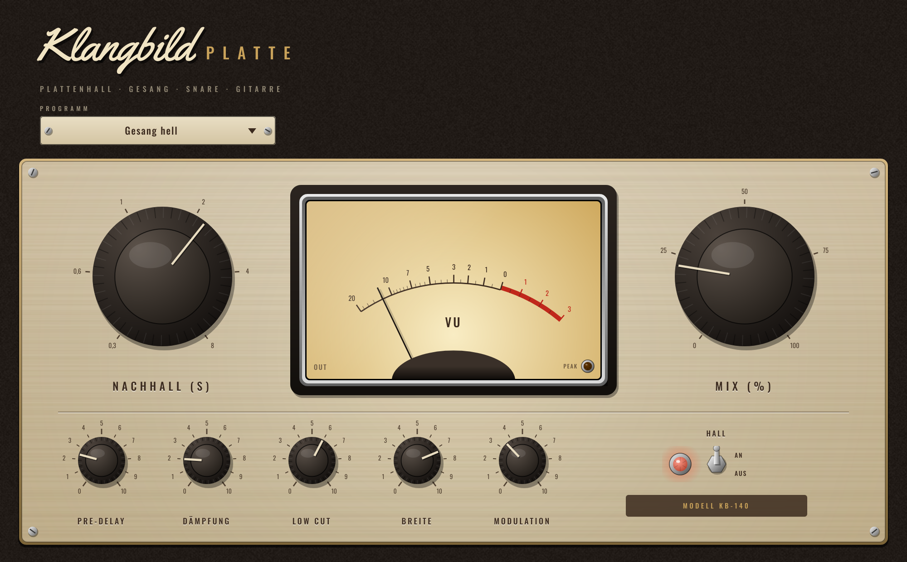

# Klangbild Platte

Plattenhall im Stil der großen Studio-Hallplatten der 60er und 70er – dicht, glatt, hell, ohne
„Raum“. Ideal für Gesang, Snare und Gitarre. Audio Unit für Logic Pro (außerdem VST3 und
Standalone), gebaut mit [JUCE](https://juce.com). Algorithmus nach Jon Dattorros Plattenhall-Struktur.



## Bedienung

| Regler | Wirkung |
|---|---|
| **Nachhall** | Nachhallzeit T60, 0,3 … 8 s |
| **Mix** | Anteil Hall (0 … 100 %, gleiche Lautheit) – **100 % für den Einsatz als Send/Aux** |
| **Pre-Delay** | Verzögerung bis zum Hall (0 … 250 ms) – trennt den Hall vom Gesang |
| **Dämpfung** | Höhenverlust im Ausklang: links hell und glänzend, rechts dunkel und weich |
| **Low Cut** | Hochpass nur im Hall (20 … 800 Hz) – hält den Mix sauber |
| **Breite** | 0 % mono · 100 % normal · 150 % extra breit |
| **Modulation** | leichtes Schweben der Hallfahne, verhindert metallisches Klingeln |
| **Hall An/Aus** | weicher Bypass; aus = Signal bleibt bitgenau unverändert |

Das VU-Meter zeigt den Ausgang (0 VU = −18 dBFS). Lange Hallzeiten werden automatisch ausgeglichen –
beim Drehen am Nachhall ändert sich die Lautstärke des Halls kaum.

### Presets
Standard · Gesang hell · Snare-Platte · Kurze Platte · Lange Ballade · Gitarre warm · Send/Aux (100 % Hall)

### Tipp für Logic
Am besten auf einen **Aux/Bus** legen (Preset „Send/Aux“) und Gesang bzw. Gitarre per Send hinschicken –
so teilen sich mehrere Spuren eine Platte, wie früher im Studio.

### Messwerte (44,1 kHz)
| Einstellung | 0,5 s | 1 s | 2 s | 4 s | 8 s |
|---|---|---|---|---|---|
| gemessene T60 | 0,55 s | 1,03 s | 2,01 s | 4,07 s | 7,98 s |
| Hallpegel (Rauschen −20 dBFS) | −19,3 | −20,0 | −20,0 | −19,5 | −18,9 dBFS |

Links/rechts unkorreliert (Korrelation ≈ 0), unabhängig von der Samplerate.

## Installation in Logic Pro

Tab **Actions** → letzter grüner Lauf → **Artifacts** → `Klangbild-Platte-macOS`, dann:

1. `Klangbild-Platte-AU.zip` entpacken → `Klangbild Platte.component`
2. Finder → ⇧⌘G → `~/Library/Audio/Plug-Ins/Components` → Datei hineinkopieren
3. Einmal im Terminal:
   ```
   xattr -dr com.apple.quarantine ~/Library/Audio/Plug-Ins/Components/"Klangbild Platte.component"
   ```
4. Logic starten: **Audio Units → Klangbild → Klangbild Platte**

## Lizenzen

Schriften *Oswald* (OFL 1.1) und *Yellowtail* (Apache 2.0) – Lizenztexte in `Resources/`.
JUCE: AGPLv3 bzw. kommerziell – für den privaten Gebrauch unproblematisch.
